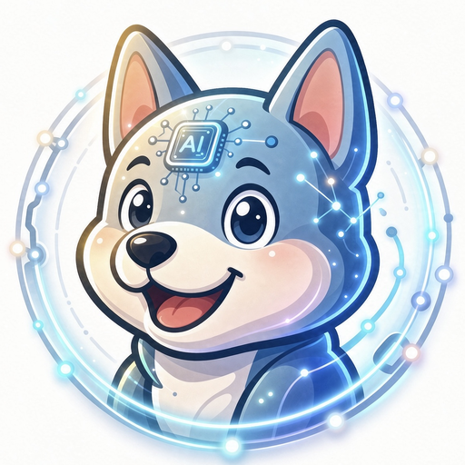

<p align="center">
  
</p>

<h1 align="center">I'm AiDog</h1>

<p align="center">
  <em>Your loyal AI companion</em><br>
  <strong>grown for one, built for anyone</strong><br>
  A personal embodied AI — a constitution for a personality, curated memory
  for a life, and a self-developed core that answers to you alone.<br>
  Not a platform. Not an assistant farm. One companion, grown for one person,
  engineered so anyone can run it.
</p>

<p align="center">
  <a href="https://github.com/AiDog-im/AiDog/releases"></a>
  <a href="https://aidog.im"></a>
  
  
  
</p>

<p align="center">
  <a href="#about">About</a> ·
  <a href="#highlights">Highlights</a> ·
  <a href="#architecture">Architecture</a> ·
  <a href="#quick-start">Quick Start</a> ·
  <a href="#verify">Verify</a> ·
  <a href="#quality-gates">Quality Gates</a> ·
  <a href="#documentation">Documentation</a> ·
  <a href="#roadmap">Roadmap</a> ·
  <a href="#versioning--updates">Versioning</a> ·
  <a href="#security-posture-honest">Security</a> ·
  <a href="#license--pricing">License</a> ·
  <a href="README_cn.md">简体中文</a>
</p>

> 🌍 **Public repository** (published 2026-10-27) — issues, discussions and
> pull requests are open. This repository is the product itself: source,
> documentation, deployment and tests.
> 🟢 **Permanently free — forever, no exceptions.** No paid tier, no usage
> fees, no feature locked behind a payment. Ever.

## About

I'm AiDog is a **personal embodied AI companion** that runs on your own
machine. (**aidog.im is this documentation site** — there is no hosted web
app to sign into; the product is the open-source repository you clone and
run locally, and its console listens on `127.0.0.1` only.) It is built around three ideas that most assistants skip:

- **A constitution for a personality.** `SOUL.md` sits at the top of every
  reply's context. Red lines, tone, and operating principles are not
  prompt-afterthoughts — they are re-applied on every single turn.
- **Curated memory for a life.** Memory lives in plain Markdown with hard
  budgets (`MEMORY.md`, `USER.md`, archives) and a digital-memory protocol:
  one source of truth, cross-kernel recoverable, write-back on every reflect.
  No vector store you cannot read or audit.
- **A self-developed core.** The runtime kernel (`mycore`) is written from
  scratch in this repository — an honest function-calling loop with explicit
  stop reasons, **40 modules ≈ 24.5k LOC, 2,449 tests**, and zero upstream
  dependencies after the core swap. Swap the kernel, never swap "me".

It talks to you over **Telegram**, a **loopback web console**, a
**desktop HUD shell**, and **voice** — with a 9-route channel gateway,
skills with a deterministic pre-router, natural-language scheduling,
subagents, MCP, and an institutional self-evolution loop (`/learn`,
`/reflect`, lint-gated writes) whose maturity grows with use.

**Platforms.** Linux via `install.sh` (the reference path, fully tested,
including WSL2 on Windows), Windows through the same WSL2 command **plus a
native portable shell** (zip on the GitHub Release, attach-only to the
WSL2 console, selftest-verified), macOS expected-but-untested, and
iOS/Android through the chat channel plus the website — the console binds
loopback-only on your own machine, so phone
access is an SSH tunnel, never a cloud console. The honest matrix lives on
the site's Platforms section; the guide is [docs/installation.md](docs/installation.md).

**Web3, gated by a human.** Since v0.5.38 nine venues live in one catalog
behind six `exchange_*` tools — public market data needs no credential,
account and order tools are slot-gated (no slot → tool does not register).
Every order runs `prepare` (dry-run plan) → the owner approves it in the
console → `execute(plan_id)`; caps default to `0`, market orders never
auto-approve, and withdrawals / on-chain transfers do not exist in the
code at all.

Everything is **free forever**: no subscription, no paid feature gate,
and **no telemetry in the product runtime** — the only counting anywhere is
an optional anonymous usage ledger (**off by default**, opt-in from Settings)
plus the marketing site's public visit counter, documented as such. You bring a
model key (or use the zero-key trial path) and the whole product activates.

## Highlights

|  | Capability | What it provides |
|---|---|---|
| 🧬 | **Self-developed core** | `mycore`: FC loop with honest stop reasons, fail-closed service, watchdog, doctor health gate — 40 modules, 2,449 tests, zero upstream |
| 🎭 | **Constitution persona** | `SOUL.md` first in the system stack; red lines and tone enforced every reply, not sampled from a persona prompt |
| 🧠 | **Curated memory** | Bounded Markdown budgets + archive tiers + digital-memory protocol; `memory` suite 58/58 |
| 🧩 | **Skills + deterministic router** | `SKILL.md` frontmatter (industry-standard fields), route pre-filter picks TOP3 *before* any body loads — 37/37 |
| ⏰ | **Natural-language cron** | `/cron ship the report tomorrow 9am` → parsed, validated, scheduled — fail-closed until you enable it |
| 🤝 | **Subagents & execute_code** | ≤3 isolated parallel delegates with fresh context; ≤8-step folded code runs with checkpointed writes |
| 🔌 | **MCP client** | stdio + HTTP servers, tool allow/deny filtering, credential slots, progress streaming |
| 🔗 | **Web3 exchange, approval gate** | **9 venues** in one catalog behind **six `exchange_*` tools** — market data keyless, account/order tools slot-gated (no slot → tool not registered); `prepare` (dry-run plan) → owner approves in the console → `execute(plan_id)` — caps default `0`, market orders **never** auto-approve, withdrawals & on-chain transfers **absent by construction** |
| 📡 | **Channel gateway** | **9 adapter routes + live Telegram** — Discord / Slack / Email / Webhook / DingTalk / Feishu / WeChat / WhatsApp / Signal adapters with per-route honest status |
| 🔑 | **Zero-key onboarding** | Start with a trial model or bring your own key; secrets live in `secrets.env` (0600) and are **never echoed** — slot names only |
| 💬 | **Streaming everywhere** | Provider SSE streaming, Telegram typing heartbeat, console chat cards with streamed replies |
| ⚡ | **Local & portable** | stdlib-only core (voice/image extras lazy-load), service bound to local loopback, SSE streaming throughout, `execute_code` folds multi-step runs into one round trip |
| 🖥️ | **Loopback web console** | Ten views — Overview · Chat · Skills · Stream · Sniff · Exchange · Community · Evolution · Help · Settings (Usage & Cost and Voice are cards): activation checklist with fix deep-links, credential slot editor (37 editable slots — names + lengths only, values never rendered), cron list with delete, capability grid, channel forms with send test, hooks editor, evolution schedule, Web3 caps, a **Connections** card (Cloudflare + GitHub token slots, a per-permission scope checklist with a read-only default posture, and a real read-only test call) and a **Bridge** card (a reverse proxy YOU deploy on your own account — explicit target allow-list, one-click kill switch, one audit line per proxied request), plus a **Backup & Restore** card (one passphrase-protected `.ckx` file of credentials · settings · memory, encrypted in the browser with an in-page round-trip check before the download) whose **AGENT BACKUP** section schedules the same encrypted run through the vendored CKX CLI — Node probe, passphrase-slot presence, a local call meter and a one-click MCP switch, all read from the server, bound to `127.0.0.1`, token-gated writes |
| 🖼️ | **Media built in** | Local STT voice sessions with fuzzy wake phrases, TTS announcements, BYOK image generation, Telegram photo send |
| 🖥️ | **Desktop HUD shell** | Electron frameless shell: transparency slider, always-on-top, tray — Linux packaging verified (Win/macOS not built yet, honestly) |
| 👥 | **Multi-profile isolation** | `AIDOG_PROFILE` selects fully isolated profiles (settings / secrets / state / body) — 63/63 isolation gate + 18-leg real-machine E2E |
| 🩺 | **Self-healing ops** | `aidog doctor` health checks + a one-click **Run doctor** button in the console, restart watchdog, one-command upgrades with a dirty-tree guard, plus in-console **restart / update check / update apply** controls |
| 🆓 | **Permanently free** | A permanent product commitment: zero paid touchpoints in product, docs, or packages — introducing one is treated as a defect |

## Architecture

```text
┌───────────────────────────────────────────────────────────────────┐
│  Entry points                                                     │
│   Telegram · Web console (127.0.0.1) · Desktop HUD · Voice · CLI  │
└──────────────────────────────┬────────────────────────────────────┘
                               │
┌──────────────────────────────▼────────────────────────────────────┐
│  Kernel layer — mycore (self-developed, replaceable, zero upstream)│
│   loop · tools · memory · compact · scheduler · subagents · mcp    │
│   checkpoint · modeltier · channels(9) · exchanges                 │
│   stt/imagegen · browser                                           │
└──────────────────────────────┬────────────────────────────────────┘
                               │
┌──────────────────────────────▼────────────────────────────────────┐
│  Body layer — overlay/ (owned by this repo, kernel-independent)    │
│   constitution (SOUL) · memory slots · skills · hooks · locales    │
└──────────────────────────────┬────────────────────────────────────┘
                               │
┌──────────────────────────────▼────────────────────────────────────┐
│  Business layer — adapters/ · web/ · desktop/ · deploy/            │
│   model provider (BYOK) · channel credentials · console · shells   │
└───────────────────────────────────────────────────────────────────┘
```

Three-layer separation is the whole point: **swap the core, never swap
"me". The kernel is replaceable, the body layer and business assets are ours.

## Quick Start

> 🌍 **Public repo:** `git clone` needs no credentials at all. A machine-wide
> `credential.helper` (e.g. a logged-in `gh`) can still shadow auth for other
> remotes — see [`docs/installation.md`](docs/installation.md).

```bash
git clone https://github.com/AiDog-im/AiDog.git aidog && cd aidog  # public repository
bash deploy/install.sh        # one command: provision + boot + verify
aidog setup                   # guided wizard: fills the slots it lists
```

`deploy/install.sh` is idempotent (safe to re-run) and reports exactly what
is missing — **by slot name, never by value**:

| Exit code | Meaning |
|---|---|
| `0` | Fully ready — doctor clean, service provisioned, console healthy |
| `2` | Installed, but credential / model slots still pending (fail-closed by design) |
| `1` | Hard failure (missing prerequisite, port conflict, boot failure) |

`aidog setup` is the interactive follow-up: it prompts only for slots that
are still empty, hides input, validates every write, and never echoes a
value. Flags: `--check` (read-only report), `--yes` (non-interactive),
`--no-boot` (provision without starting services).

Then:

1. Open the console at **http://127.0.0.1:19167**
2. Settings panel → add your model endpoint + key, Telegram bot token +
   allowlist (or run `aidog setup` instead)
3. Chat card → send one message — a streamed reply means the model chain is
   live
4. Telegram → message your bot `/help` from an allowlisted account

Full guide: [`docs/installation.md`](docs/installation.md).

## Commands

**Telegram** (allowlisted chats only; full reference with examples:
[`docs/commands.md`](docs/commands.md)):

| Command | One line |
|---|---|
| `/help` | list every command |
| `/reset` | archive this chat's session, start fresh |
| `/rewind [n]` · `/rewind` (as a reply) | drop the last n messages, or from the replied message onward |
| `/model [id]` | show or set this chat's model |
| `/status` | turns · model · uptime |
| `/lang [code]` | show or switch the reply language |
| `/learn memory <text>` / `/learn skill <slug> :: <desc> :: <body>` | record an experience (lint-gated) |
| `/reflect [daily\|weekly\|monthly]` | draft the period reflect skeleton (facts only) |
| `/evolution` | self-evolution loop status |
| `/cron [add [message\|prompt] <spec> :: <text> \| del <id> \| pause <id> \| resume <id> \| run <id> \| catchup <id> on|off]` | natural-language cron jobs + per-job pause/resume/run/catch-up (0.5.84) |
| `/checkpoint [restore <id>]` | file checkpoints + rollback |
| `/version` | installed vs latest release |

**Local CLI**: `bash deploy/install.sh` (provision + boot + verify) ·
`aidog setup` (guided wizard) · `aidog doctor` (health gate) ·
`aidog update apply` (upgrade; `aidog update` = read-only check).

Full reference: [`docs/commands.md`](docs/commands.md).

## Verify

Automated E2E covers the stack on this machine; a **manual spot-check**
completes the acceptance pass. Quick version:

```bash
python3 deploy/aidog_doctor.py       # health gate: 13 checks · 0 FAIL · 20 SKIP
bash deploy/boot_services.sh status  # console + service + watchdog green
bash deploy/run_service.sh --check   # readiness rc=0
python3 deploy/aidog_update.py check # version channel: up to date
```

Walk the console views (Overview → Settings round-trip → chat card →
Stream → Exchange → Evolution), send a Telegram `/help`, and confirm you
never see a raw secret anywhere. The complete checklist — including a
fresh-machine install path — lives in
**[`docs/manual_verification.md`](docs/manual_verification.md)**.

## Quality Gates

Every release is cut only after these run green on a clean tree:

| Suite | Result |
|---|---|
| `mycore` core suite | **2449/2449** |
| Console smoke (live HTTP) | **557/557** (on a provisioned install — needs `secrets.env`; a bare clone skips it honestly) |
| Skill router | **37/37** |
| Memory persistence | **58/58** |
| Setup wizard | **123/123** |
| Profile isolation (offline, subprocess cross-check) | **63/63** |
| Desktop shell (`node --test`) | **23/23** |
| `aidog doctor` | **0 FAIL · 0 WARN** (honest environment WARN only when egress is fully gone) |
| Publish gate (deny-by-default manifest) | **READY** |
| Real-machine E2E | profiles **18/18** · channels **12/12** · domestic channels **46/46** · pipeline **39/39** · web3 read-only **33/33** · web3 approval **61/61** · frontend coverage **62/62** · frontend UI **45/45** · activation **81/81** · activation UI **50/50** · settings matrix **63/63** + UI **20/20** · missions **54/54** · mission-orch **63/63** · mission-pause **73/73** · skills catalog **187/187** · skills remote **58/58** · skills install API **65/65** · skills UI **23/23** · skills parity **68/68** · gateway UI **26/26** · ckx round-trip **28/28** · console UI probes **21/21** + **22/22** · region API **28/28** · region UI **20/20** |

Catalog scope: **28 registered tools** · **9 exchange venues** · **28
real-machine E2E suites** — all green.

Locale packs: `en` (default) + `zh`, **1544 keys** each, parity lint in CI;
the marketing site ships its own **382-key** bilingual pack.

## Documentation

- [`docs/installation.md`](docs/installation.md) — install, slots, wizard
- [`docs/features/`](docs/features/) — **37 capability documents**, one per
  feature (channels, memory, cron, subagents, MCP, voice, desktop,
  profiles, tool toggles, …), each with its honest boundaries
- [`docs/manual_verification.md`](docs/manual_verification.md) — manual
  acceptance checklist
- [`docs/security_checklist.md`](docs/security_checklist.md) — security
  review list
- **[aidog.im](https://aidog.im)** — product site (bilingual, PWA,
  AI-readable `llms.txt`)

**All 37 at a glance** (grouped, one line per group):

- **Agent loop & tools** — [`acp`](docs/features/acp.md) (ACP v1 stdio server) · [`openai_api_server`](docs/features/openai_api_server.md) (OpenAI-compatible `/v1` gateway) · [`terminal_backends`](docs/features/terminal_backends.md) (7-backend `run_bash` matrix) · [`execute_code`](docs/features/execute_code.md) · [`subagents`](docs/features/subagents.md) · [`mcp`](docs/features/mcp.md) · [`tool_toggles`](docs/features/tool_toggles.md) · [`browser_automation`](docs/features/browser_automation.md) · [`model_failover`](docs/features/model_failover.md) · [`model_gateway`](docs/features/model_gateway.md) (structured endpoints, rotation, rate caps, self-metering) · [`missions`](docs/features/missions.md) (never-sleeps mission loop) · [`community_posting`](docs/features/community_posting.md) (in-app Discussions posting + slot verification)
- **Knowledge & memory** — [`memory_and_routing`](docs/features/memory_and_routing.md) · [`checkpoints`](docs/features/checkpoints.md) · [`context_files`](docs/features/context_files.md) (project instruction files) · [`evolution_loop`](docs/features/evolution_loop.md) · [`connectors`](docs/features/connectors.md) (read-only Linear/Notion search)
- **Sense & proactivity** — [`sniff`](docs/features/sniff.md) (the read-only SNIFF sweep engine: health/home/vehicle/web sources, bounded rules, findings, speak-first delivery)
- **Channels & media** — [`channels`](docs/features/channels.md) · [`channels_domestic`](docs/features/channels_domestic.md) · [`console_chat`](docs/features/console_chat.md) · [`voice_session`](docs/features/voice_session.md) · [`voice_announcements`](docs/features/voice_announcements.md) · [`tts_engines`](docs/features/tts_engines.md) · [`image_generation`](docs/features/image_generation.md)
- **Ops & console** — [`setup_wizard`](docs/features/setup_wizard.md) · [`regional_visibility`](docs/features/regional_visibility.md) (explicit region tier: exchange hide, channel dim, activation requiredness) · [`frontend_coverage`](docs/features/frontend_coverage.md) · [`capabilities`](docs/features/capabilities.md) · [`desktop_client`](docs/features/desktop_client.md) · [`profiles`](docs/features/profiles.md) · [`site_visibility`](docs/features/site_visibility.md) · [`zero_key_onboarding`](docs/features/zero_key_onboarding.md) · [`natural_language_cron`](docs/features/natural_language_cron.md) · [`event_hooks`](docs/features/event_hooks.md)
- **Web3** — [`exchanges`](docs/features/exchanges.md) (nine venues, orders behind a human approval gate)
- **Skills ecosystem** — [`skills_ecosystem`](docs/features/skills_ecosystem.md) (official directory, public skills repo, dual-gate review, remote catalog API)

This repository ships exactly what the product needs to run and verify:
source, documentation, deployment and tests.

## Roadmap

- **Now** — Web3 phase-2 is live: **W1 + W2 shipped in v0.5.38** (nine-venue
  catalog, `prepare` → owner approval → `execute`); parity hardening and
  polish continue under owner acceptance — every capability ships with tests
  and an honest boundary note.
- **Next** — the remaining Web3 stage (identity & payments: ERC-8004 on-chain
  agent identity, x402 read-only paid calls, official MCP opt-in mounts),
  researched and staged for a coming release.

## Versioning & Updates

- Version truth = `VERSION` (semver) + `release.json` (date + notes);
  both bump together, every release is tagged `vX.Y.Z` and published as a
  **GitHub Release** (the discovery channel).
- Upgrade: `aidog update apply` → dirty-tree guard →
  fetch → `--ff-only` → restart runtime. The console shows an upgrade
  banner automatically when a newer release exists.

## Security Posture (honest)

- Loopback by default; console writes are bearer-token gated; credentials
  live only in `secrets.env` (0600) and are **never echoed** — slot names
  only, in logs, status, and errors.
- Fail-closed everywhere it matters: channel allowlists, profile names,
  settings validation, upgrade guard.
- Single-owner design = strangers are not part of the attack surface.
- **Honest limits:** no third-party audit and no CVE disclosure channel
  *yet* — public but unaudited. We claim a small attack surface by design,
  never "audited".

## Language / i18n

- Source code, comments, and markdown docs: **English** (international
  route). This file has a full Chinese mirror: [`README_cn.md`](README_cn.md).
- UI strings: locale packs under `overlay/locales/` — default **`en`**,
  switchable **`zh`**, new languages added as packs with zero code changes.

## License & Pricing

**Free forever — for any use.** I'm AiDog ships with **zero paid
touchpoints**: no paid tier, no in-app purchases, no usage fees, no feature
locked behind payment. Adding any charge to this product is treated as a
defect.
